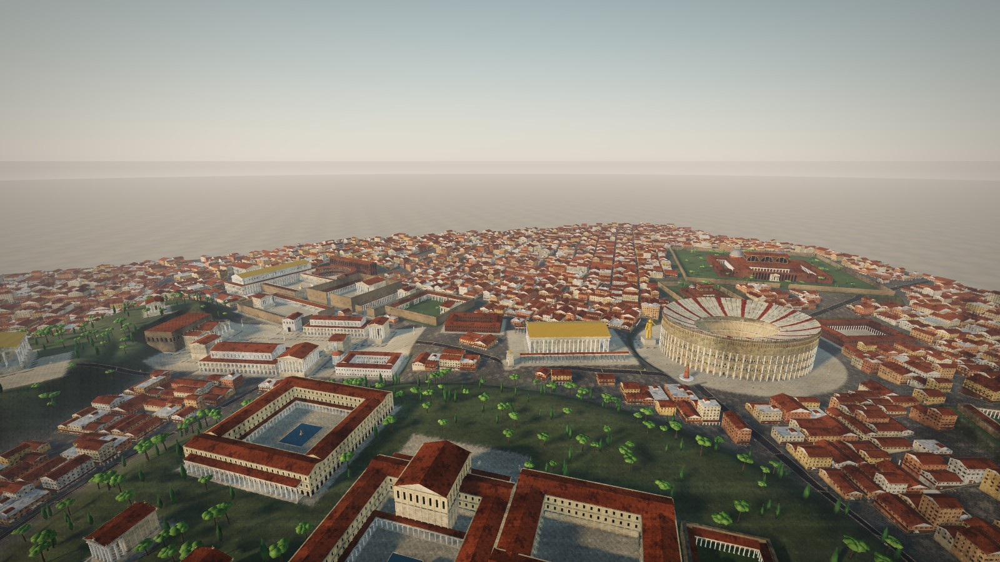
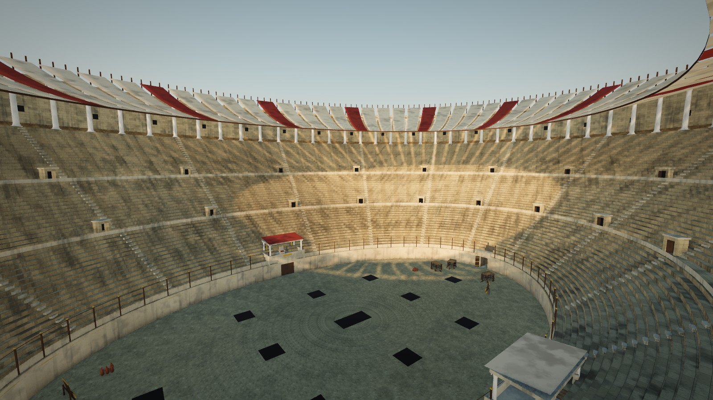
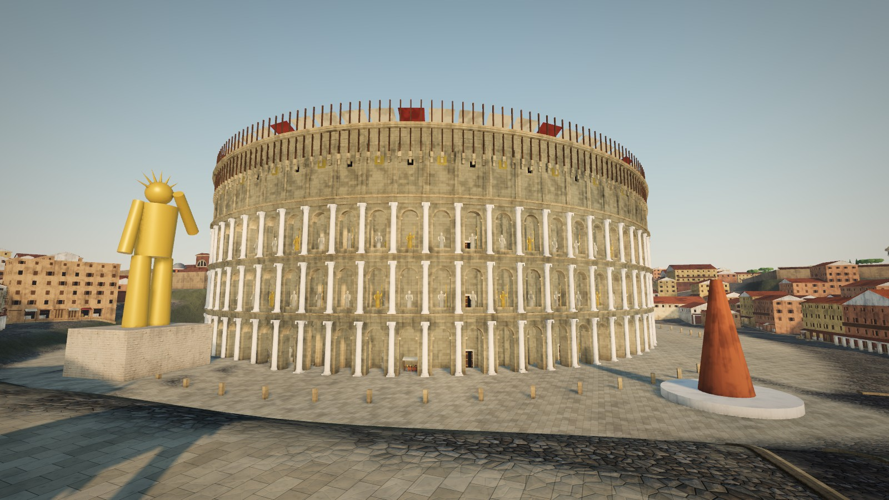
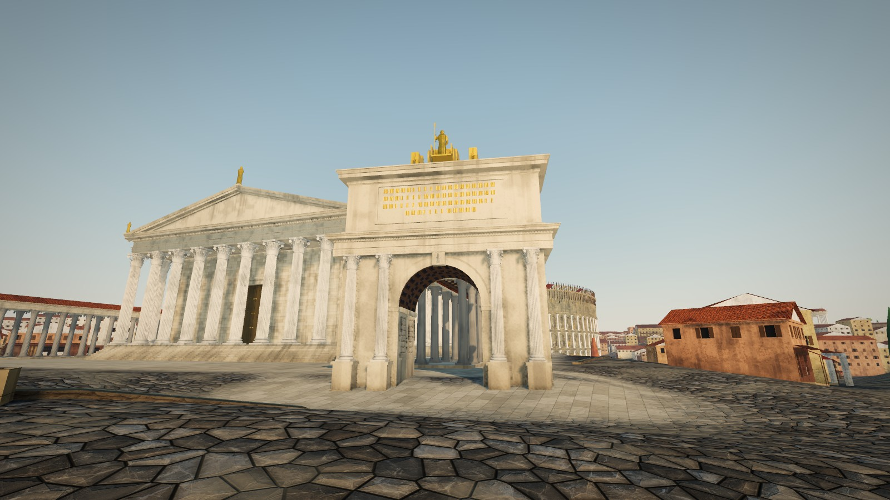
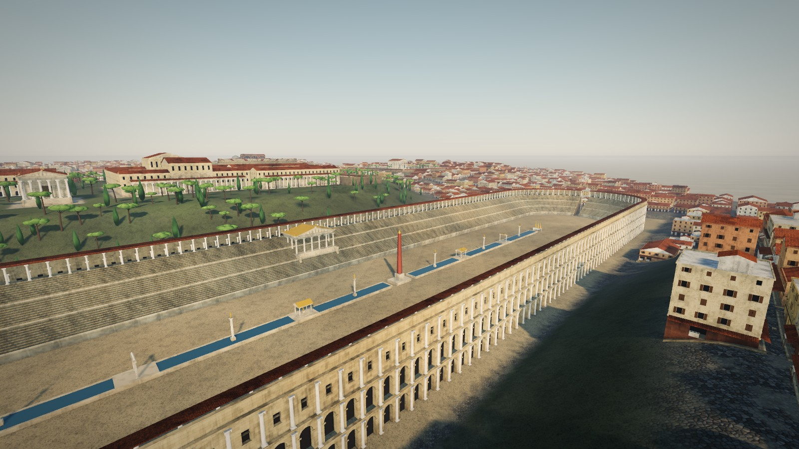
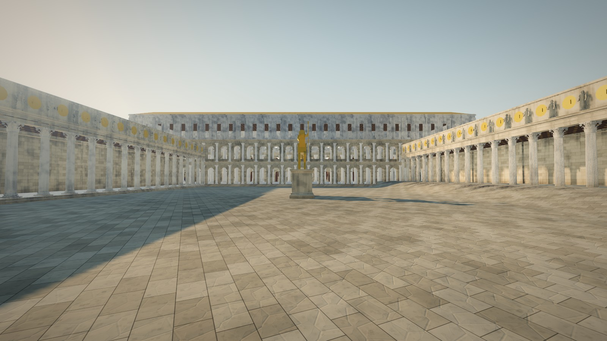
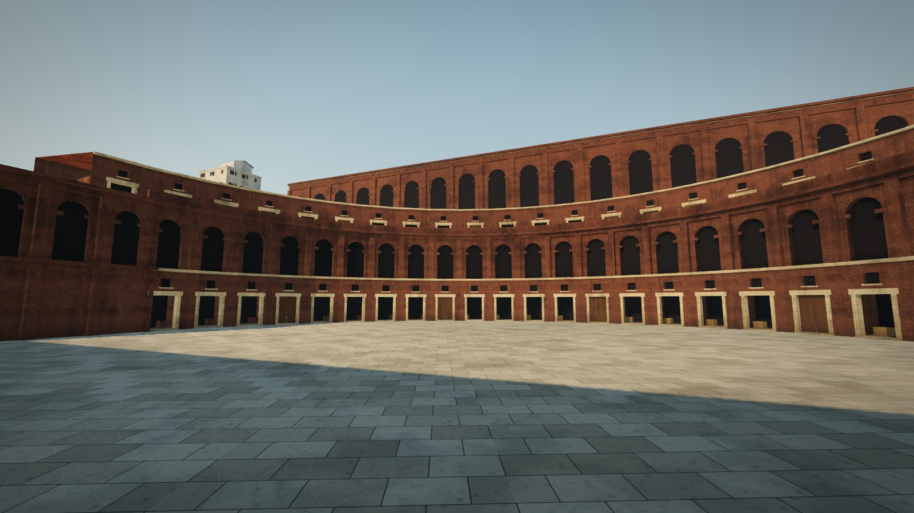
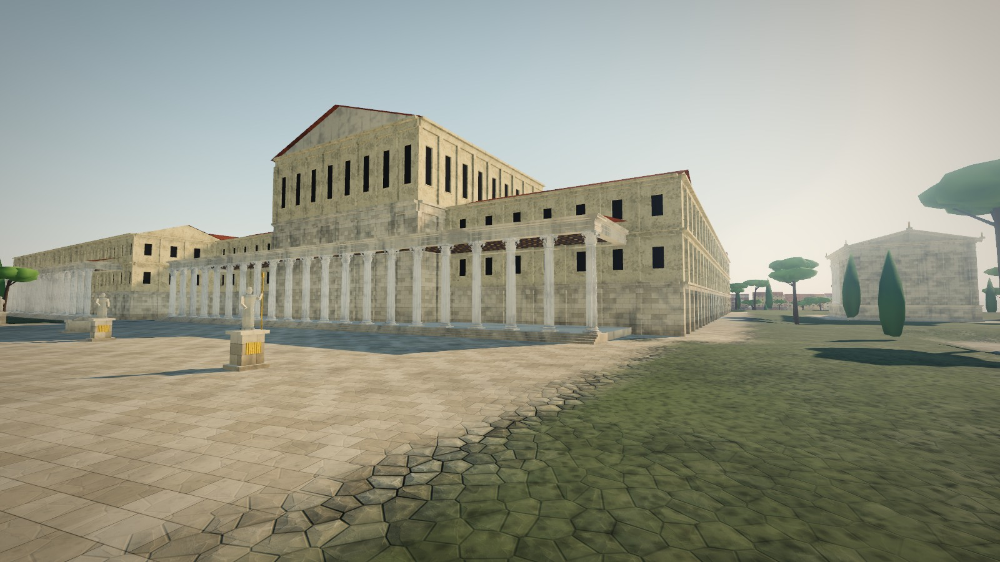
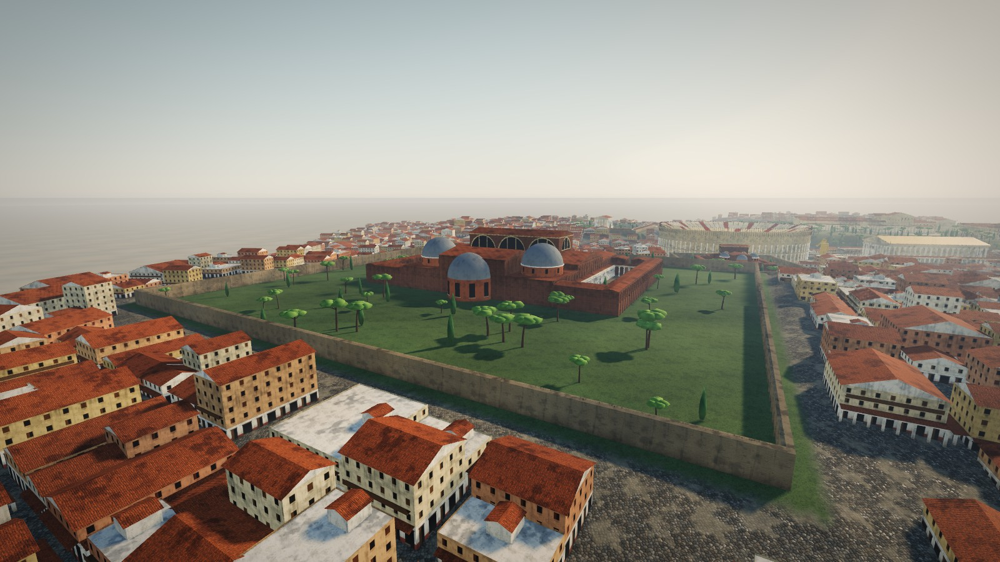

# Roma · AD 180

> Rome ne fu[t] pas faite toute en un jour mais Fable 5.2 l'a faite en deux.



A walkable model of the centre of ancient Rome as it stood in AD 180, the last year of Marcus
Aurelius. It runs in the browser. You can walk the streets, climb the Colosseum to its top
gallery, and fly over the city. Anything built after 180 is left out.

**Try it:** <https://res-publicae.github.io/roma/>

There are no people yet. The plan is to get the buildings to a convincing level first.

> **A note before you look:** this is not the work of a historian. It is a hobby project, made
> mostly to have fun trying out AI tools and workflows: coding assistants, research agents that
> check sources, image-to-3D models. Much of the model is checked against published sources,
> but much is simplified, guessed or simply invented to fill gaps. Treat it as an impression of
> Rome, not a reference, and don't cite it.

## Screenshots

| | |
|---|---|
|  |  |
| Inside the Colosseum, with the awning rigged | The Colosseum, with the Colossus of Sol |
|  |  |
| The Arch of Titus and the Temple of Venus and Roma | The Circus Maximus under the Palatine |
|  |  |
| Trajan's Forum and the Basilica Ulpia | The Markets of Trajan |
|  |  |
| The imperial palace on the Palatine | The Baths of Trajan, with the Colosseum beyond |

## Run it locally

Nothing to install or build. Serve the folder and open it in a browser:

```bash
python3 serve.py 5173
```

Then go to <http://localhost:5173>. `serve.py` is Python's built-in web server with caching
turned off, so edits show up on reload. Any static server works: the site has to be served
over http, because browsers block ES modules opened from `file://`.

three.js is loaded from a CDN, so the first load needs an internet connection.

### Controls

| Key | Action |
|---|---|
| `W A S D` | walk (`Shift` to run) |
| Mouse | look around (click to capture, `Esc` to release) |
| `F` | fly on/off; `E` / `Q` up and down |
| `[` `]` | earlier / later in the day (06:30–19:00) |
| `1`–`9` | jump to a place |
| `P` | post-processing effects on/off |
| `H` | hide the help panel |

The places are: Forum Romanum, Via Sacra at the Arch of Titus, Colosseum, arena floor,
Forum of Trajan, Capitoline, Palatine, Circus Maximus, and a view from above the city.

## What's in it

- **47 monuments** placed from their real coordinates or laid out from published plans: the
  Forum with its temples and basilicas, the Colosseum, the imperial fora, the Palatine palaces,
  the Circus Maximus, the Baths of Titus and Trajan, triumphal arches and more.
- **The Colosseum in depth:** real rows of seats, the arena with its trapdoors, the imperial
  box, a ring corridor with stalls, statues and braziers, staircases climbing to the top
  gallery, and the awning hung from its masts.
- **About 4,600 apartment blocks** on street grids that change from district to district. Near
  the walking places they have built shop fronts, windows and shutters, raised pavements,
  stepping stones and fountains.
- **Light and atmosphere:** a sky and sun that follow the time of day, four-cascade sun
  shadows, ambient occlusion, dust haze that thickens in the valleys, weathering on every
  surface, and firelight at dusk.

It is still a reconstruction sketch. Many details are simplified or invented, especially the
ordinary housing, of which almost nothing is recorded. Notes in `src/sites.js` say which
positions are conjectural.

## How it's organised

```
index.html          page, heads-up display, import map for three.js
serve.py            local no-cache web server
src/
  main.js           renderer, sky and sun, shadows, post-processing, frame loop
  sites.js          data: every monument's position, size, orientation and date,
                    the hills, roads, river, housing districts and the jump-to places
  builders.js       one builder per kind of building (temple, basilica, arch,
                    amphitheatre, circus, baths, palace, …) and the column models
  fora.js           the imperial fora: Augustus, Caesar, Nerva, and the Temple of Peace
  facade.js         wall bays with real openings: arches, windows, niches, parapets
  geobuf.js         geometry buffers merged per material, and shape helpers
  city.js           apartment blocks, house fronts, streets and pavements, trees
  terrain.js        height field, building pads, and the collision solids
  materials.js      textures (photographs and generated), materials, weathering shader
  player.js         first-person walking and flying, with multi-level collision
  util.js           maths helpers and the latitude/longitude → metres conversion
textures/           Poly Haven photo textures (stone, brick, plaster, roof tiles, sand)
docs/ROADMAP.md     state of each monument, to-do list, sources
docs/screenshots/   the images in this README
```

A few design choices:

- **Data first.** `sites.js` holds what was where; the builders turn each entry into
  geometry. Each site has a `built` year, and the scene keeps only what existed in AD 180.
- **Few draw calls.** All geometry of one material is merged into large meshes, filed by
  520 m square so off-screen parts of the city are skipped. Columns are instanced, and
  detailed fluted columns switch to simple ones beyond 160 m.
- **Walls with depth.** Facades are built bay by bay with arches and windows actually cut
  into them, not painted on.
- **Generated textures where photos fall short.** Marble, travertine, opus sectile floors,
  coffered ceilings, basalt paving and the spiral relief of Trajan's Column are drawn
  in code at load time.
- **Walkable buildings.** Collision solids can be slabs with open space beneath, so upper
  floors, stairs and galleries can be walked on.

## Changes and plans

See [CHANGELOG.md](CHANGELOG.md) for what has changed, and [docs/ROADMAP.md](docs/ROADMAP.md)
for the state of each monument, the to-do list and the sources.

## Credits

- [three.js](https://threejs.org) 0.170 (MIT), loaded from jsDelivr.
- Photo textures from [Poly Haven](https://polyhaven.com) (CC0).
- Built with Claude (Anthropic).

## License

[MIT](LICENSE) © 2026 res-publicae. The Poly Haven textures in `textures/` are CC0.
